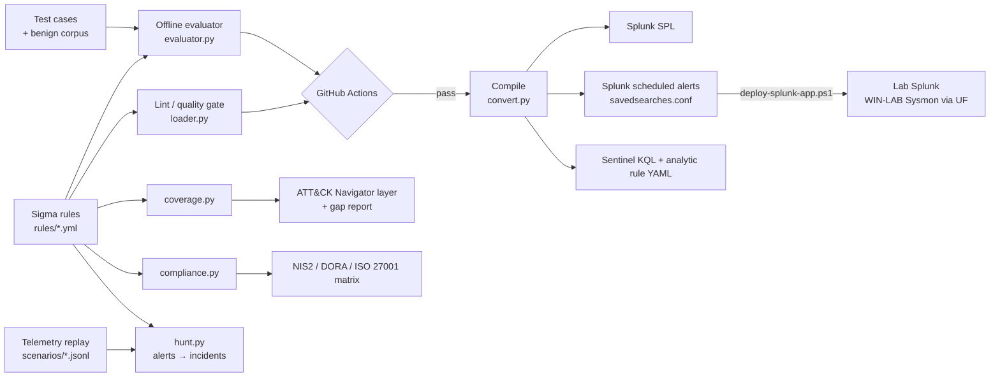

# DetectForge — Detection-as-Code for a Modern SOC

> Write detections like software: **Sigma rules → automated tests → CI → SIEM-ready content → ATT&CK coverage → compliance traceability.**
> Built by a computing graduate (SC-200, ISO 27001 Lead Auditor) to show the full detection-engineering lifecycle, not just "I installed a SIEM".

    

## Why this exists

Most SOCs fail on **detection quality**, not tooling: untested rules, alert fatigue, no idea what they can/can't detect, and no link
between security monitoring and regulation. In Ireland/EU that last point matters — **NIS2** and **DORA** now require demonstrable
detection and incident-handling capability. DetectForge tackles all four problems in one small, readable codebase.

| Problem in real SOCs | What DetectForge does |
|---|---|
| Rules pushed to prod untested | Every rule needs **true-positive + benign unit tests**; CI blocks merges that fail |
| Alert fatigue | Replays a **benign corpus** on every commit — any new false positive fails the build |
| "What can we actually detect?" | Generates an **ATT&CK Navigator layer** + gap report vs a priority technique list |
| Vendor lock-in | Vendor-neutral **Sigma** compiled to **Splunk SPL**, **Sentinel KQL** and **Sentinel analytics-rule YAML** |
| Isolated alerts, no story | **Correlation engine** groups alerts per host into a kill-chain **incident** with a risk score |
| "Works on my laptop" detections | Rules are **deployed as scheduled Splunk alerts** in a home lab and proven against **real Sysmon telemetry** |
| SOC ↔ GRC disconnect | **Traceability matrix**: each detection → NIS2 / DORA / ISO 27001:2022 controls |

## Architecture



## Quick start

```bash
git clone <your-repo> && cd detectforge
pip install -r requirements.txt

python -m detectforge validate     # lint gate: ATT&CK tags, UUID, false-positive guidance, tests exist
python -m detectforge test         # TP/FP unit tests + 300-event benign corpus
python -m detectforge coverage     # out/COVERAGE.md + out/attack_layer.json (load in ATT&CK Navigator)
python -m detectforge convert      # out/splunk (+ savedsearches.conf alerts), out/kql, out/sentinel
python -m detectforge compliance   # out/TRACEABILITY.md
python -m detectforge hunt data/scenarios/ransomware_chain.jsonl
pytest -q                          # 43 tests
```

### Demo output (`hunt`)

```
=== INCIDENT 1: host WS-042 | risk score 95 | MULTI-STAGE INTRUSION ===
kill chain: initial_access -> execution -> persistence -> defense_evasion -> credential_access -> command_and_control -> impact
  09:04:02  [HIGH    ] Office Application Spawning Script Interpreter or Shell  (T1566.001, T1204.002)
  09:04:03  [HIGH    ] Suspicious Encoded PowerShell Command  (T1059.001, T1027)
  09:09:15  [HIGH    ] Certutil Used to Download or Decode Payloads  (T1105, T1140)
  09:14:20  [CRITICAL] LSASS Memory Dump via comsvcs.dll MiniDump  (T1003.001)
  09:31:10  [CRITICAL] Shadow Copy / Backup Deletion (Ransomware Precursor)  (T1490)
  >> RECOMMENDED: isolate host, reset user creds, preserve memory image, start IR runbook
```

## Detection library (18 Sigma rules + 1 native)

Phishing macro → encoded PowerShell → certutil download → scheduled-task persistence → LSASS dump → Defender tamper →
shadow-copy deletion → log clearing, plus rundll32 proxy execution, WMI process creation, RDP enabling, admin-share
lateral movement, NTDS.dit theft, and Linux reverse-shell and curl|bash droppers. Each rule documents **false positives**
and maps to MITRE ATT&CK. See `out/COVERAGE.md` for the current gap list (currently 22/28 priority techniques, 78%).

**Native detections** (`detections_native/`): some logic can't be a single-event Sigma rule. The
**brute-force / password-spray** detection (T1110.001 / T1110.003) counts failed logons (EID 4625) per source over
15 minutes, so it's written as native Splunk SPL. It carries the same metadata as a Sigma rule (id, ATT&CK tags,
level, false positives) and is linted by `validate`. It also counts towards coverage and compliance, and deploys as
an alert like every other rule. It is *not* run by the offline evaluator; it's validated live in the lab instead.

## Home lab

| Component | Where | Role |
|---|---|---|
| Splunk Enterprise | Docker Desktop on the host, container `splunk` | SIEM: web `8000`, HEC `8088`, mgmt `8089`, forwarder input `9997` |
| `WIN-LAB` | VirtualBox, Windows 11 | Sysmon64 + Splunk Universal Forwarder, Atomic Red Team target |
| Host-only network | `192.168.56.0/24`, host = `192.168.56.1` | How WIN-LAB reaches Splunk on the host |

Forwarder (WIN-LAB) sends to `192.168.56.1:9997`: Sysmon/Operational → index `sysmon`, Security + System →
index `wineventlog`. The indexes are defined in the `detectforge_lab` app inside the container.
(`UBU-SPLUNK`, the original Splunk VM, is retired.)

Start everything with one command. It starts Docker Desktop and the container, waits until Splunk is healthy,
then boots WIN-LAB:

```powershell
powershell -ExecutionPolicy Bypass -File lab\start-lab.ps1         # start lab
powershell -ExecutionPolicy Bypass -File lab\start-lab.ps1 -Stop   # save WIN-LAB, stop Splunk
```

Inside WIN-LAB, open **http://192.168.56.1:8000**. From the host, use http://127.0.0.1:8000.

**Troubleshooting notes (learned the hard way):**
* Splunk Web here is plain **HTTP**. `https://` gets "connection reset" / curl error 35 even though
  `Test-NetConnection` succeeds: the TCP port is fine, but TLS isn't spoken.
* `netstat`/`Get-NetTCPConnection` on the host shows Docker's listeners appearing and disappearing. That's
  a reporting quirk of Docker Desktop's relay; actual connections still work. Test with `curl`, not `netstat`.
* `.wslconfig` must be named exactly that. Notepad saving it as `.wslconfig.txt` silently ignores it.
* After moving Splunk, update the forwarder's `outputs.conf` too. The old one still pointed at the retired VM,
  so nothing was indexed. Versioned forwarder config lives in `lab/forwarder/`; the Splunk-side app (indexes +
  Sysmon field extraction) lives in `lab/splunk/` and is deployed with `lab\deploy-splunk-app.ps1`.
* Security/System logs arrive but **Sysmon doesn't**? The forwarder's splunkd.log shows
  `unable to subscribe to ... Microsoft-Windows-Sysmon/Operational: errorCode=5` (access denied). Recent forwarders
  run as the low-privilege `NT SERVICE\SplunkForwarder` account. Grant it read access, as admin in WIN-LAB:
  `Add-LocalGroupMember -Group 'Event Log Readers' -Member 'NT SERVICE\SplunkForwarder'; Restart-Service SplunkForwarder`

### Lab evidence (real telemetry, not samples)

Benign simulations run in WIN-LAB (commands in [`lab/VALIDATION.md`](lab/VALIDATION.md)), detected end to end:
Sysmon → Universal Forwarder → Splunk → DetectForge scheduled alert.

| Simulation in WIN-LAB | Detection that fired | Technique |
|---|---|---|
| `powershell -EncodedCommand …` | Suspicious Encoded PowerShell Command | T1059.001, T1027 |
| `Invoke-CimMethod Win32_Process Create` | WMI Used to Launch a Process | T1047 |
| `rundll32 C:\Users\Public\x.dll,…` | Rundll32 Proxy Execution | T1218.011 |
| `copy … \\127.0.0.1\C$\…` | Admin Share Used for Remote Copy | T1021.002 |
| 12 bad-password SMB logons across 6 fake accounts | Brute Force / Password Spray (native) | T1110.003 |

Each simulated technique raised exactly one alert of the matching rule. No other DetectForge alert fired on normal
WIN-LAB activity during the run. The real Sysmon events for the first four were sanitised and added to
`tests/data/`, so CI now regression-tests the rules against genuine telemetry as well as hand-written samples.

## Writing a new detection (the workflow)

1. Copy a file in `rules/`, change the logic, tags, `falsepositives`.
2. Add `tests/data/<rule>.json` with `should_match` and `should_not_match` events.
3. `python -m detectforge validate && python -m detectforge test` — fix until green.
4. Push → CI lints, tests, compiles, and publishes SIEM content as a build artifact.
5. Validate against the real technique using [Atomic Red Team](https://github.com/redcanaryco/atomic-red-team) in your lab (see `docs/TWO_WEEK_PLAN.md`).

## Design decisions & limitations (read this — it's honest)

* **The offline evaluator supports a Sigma subset** (field modifiers, wildcards, and/or/not, `1 of`/`all of`). Aggregations (`count`, `near`) raise `NotImplementedError` instead of silently passing. Aggregation logic lives in `detections_native/` and is validated live in the lab instead.
* **Test telemetry is mostly hand-written** (modelled on Sysmon EID 1), plus real sanitised Sysmon events from the lab for the rules validated there. A single lab host is not production: real false-positive rates need real enterprise logs.
* **Lab simulations are benign stand-ins**, not real attack tooling. They reproduce the command lines the rules key on. The original rules (LSASS dump, shadow-copy deletion, etc.) still need validating with Atomic Red Team.
* **KQL output assumes a `SysmonProcessCreate` parser function** in your Sentinel workspace (configurable in `convert.py`). Field mapping between Sysmon and ASIM/Defender tables would be done with a pySigma processing pipeline.
* Compliance mapping is **indicative**, for portfolio/education use, not legal advice.
* All samples use documentation IP ranges (RFC 5737); no real malware is included.

## Roadmap

Atomic Red Team validation of the original rules (LSASS, scheduled task, shadow copies), Entra ID sign-in detections, Sigma→Elastic, Sentinel deployment via GitHub Action, MISP/OpenCTI IOC enrichment.

## License
MIT
